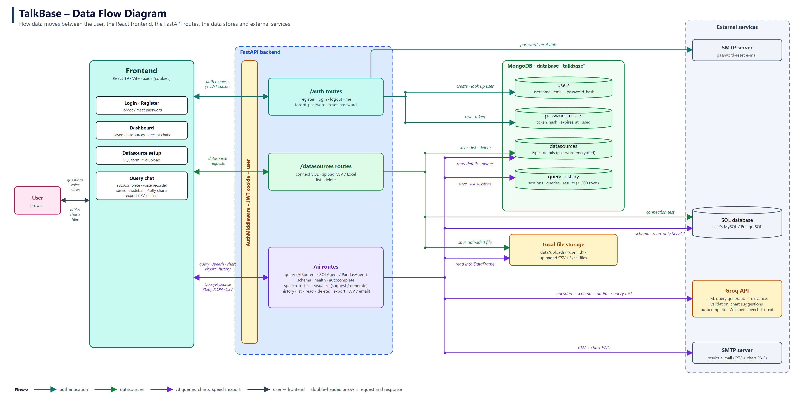
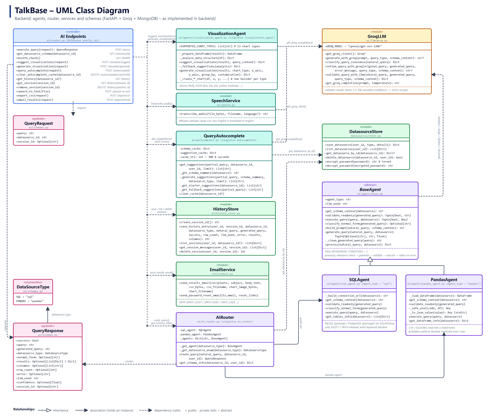
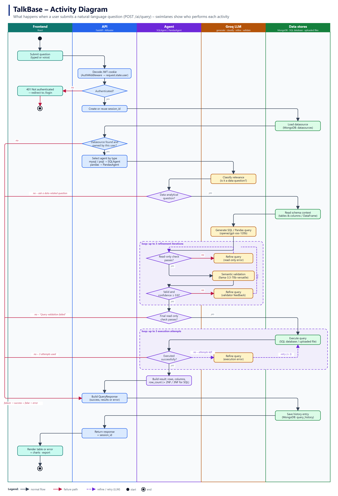
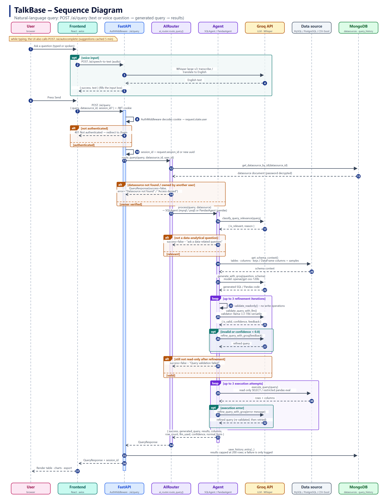

# TalkBase: A Multi-Backend Natural Language Query Platform with LLM-Powered Agent Routing and Automated Visualization

---

## Paper Structure (IEEE Conference Format)

> This document contains all the content organized in the standard IEEE conference paper structure. Each section below maps to a section of the IEEE paper. Use this as your draft for the final LaTeX/Word submission.

---

## I. TITLE AND AUTHORS

**Title:**  
_TalkBase: A Multi-Backend Natural Language Query Platform with LLM-Powered Agent Routing and Automated Visualization_

**Authors:**  
_(Add author names, affiliations, and emails here)_

**Keywords:**  
Natural Language Processing, Text-to-SQL, Text-to-Pandas, Large Language Models, Conversational Analytics, Data Visualization, Read-Only Query Enforcement, Multi-Backend Routing, FastAPI, React

---

## II. ABSTRACT

The growing demand for data-driven decision-making across organizations has exposed a critical accessibility gap: non-technical stakeholders—business analysts, operators, and domain experts—frequently lack the technical proficiency to write structured queries in SQL or Pandas code. Existing commercial solutions such as BlazeSQL, DataGPT, and Google Looker Conversational Analytics remain tightly coupled to SQL-only warehouses, are closed-source, and offer limited extensibility for hybrid database environments.

This paper presents **TalkBase**, an open-source, research-oriented conversational analytics platform that enables users to query SQL databases (MySQL, PostgreSQL) and CSV/Excel spreadsheets using natural language, typed or spoken. The system employs a modular agent-based architecture where a central AI Router dynamically dispatches user queries to specialized agents—`SQLAgent` and `PandasAgent`—based on the connected datasource type. Every question first passes a relevance guardrail; each agent then uses the Groq-hosted `openai/gpt-oss-120b` model for query generation, followed by layered validation—deterministic read-only checks (keyword and pattern matching, AST parsing) and a second LLM (`llama-3.3-70b-versatile`) acting as a semantic validator—with up to three refinement iterations before execution against the target datastore. Execution errors are repaired by the LLM and retried (up to three attempts).

The platform additionally features: (i) an LLM-driven visualization recommendation engine that analyzes query result structure to suggest and generate 13 Plotly chart types, (ii) a context-aware autocomplete engine with schema-informed suggestions and TTL caching for sub-500ms response times, (iii) a session-based query history persistence layer backed by MongoDB, (iv) voice input through Groq Whisper speech-to-text, CSV export and e-mail delivery of results, and (v) a secure authentication system with PBKDF2 password hashing, JWT cookie-based sessions, e-mailed password reset, and encrypted credential storage for connected datasources.

The frontend, built with React 19, Vite, and Tailwind CSS v4, provides a chat-based query interface with real-time autocomplete, interactive Plotly.js visualizations, session management, and multi-datasource switching. Experimental evaluation on synthetic e-commerce datasets (5,000–10,000 records across SQL and CSV) demonstrates the system's ability to correctly translate diverse natural language queries—including aggregations, joins, filters, grouping, and statistical analyses—into executable, read-only database operations across both backends.

---

## III. INTRODUCTION

### A. Background and Motivation

The proliferation of data across enterprises has created an urgent need for intuitive, code-free interfaces to databases. While business intelligence (BI) tools have evolved significantly, they still require users to understand query languages or navigate complex drag-and-drop interfaces. The emergence of Large Language Models (LLMs) with strong code generation capabilities has opened a pathway to truly natural language-driven data exploration.

However, real-world enterprise environments rarely operate on a single data backend. Organizations commonly maintain relational databases (MySQL, PostgreSQL) for transactional data, MongoDB for document-oriented workloads, and spreadsheet files (CSV, Excel) for ad-hoc analyses. Existing natural language query systems typically support only SQL, leaving a significant portion of enterprise data inaccessible through conversational interfaces.

### B. Problem Statement

The key challenges addressed by this work are:

1. **Multi-Backend Query Translation:** Translating a single natural language question into the correct query language (SQL or Pandas code) based on the connected datasource, without requiring the user to specify the target language.

2. **Read-Only Safety Enforcement:** Ensuring that LLM-generated queries cannot modify, delete, or corrupt production data—a critical requirement for enterprise adoption.

3. **Automated Visualization:** Intelligently recommending and generating appropriate visualizations from query results without requiring the user to specify chart configurations.

4. **Context-Aware Query Assistance:** Providing real-time, schema-aware autocomplete suggestions as users type their queries, reducing cognitive load and improving query quality.

5. **Secure Multi-Tenant Access:** Supporting multiple users with isolated datasource connections, encrypted credential storage, and session-based authentication.

### C. Contributions

The main contributions of this paper are:

- A **unified multi-backend architecture** that routes natural language queries to specialized agents for SQL and Pandas execution through a single API endpoint.
- A **multi-layered read-only validation pipeline** employing regex pattern matching, keyword blacklisting, AST parsing, and statement analysis to prevent destructive operations, complemented by an LLM-based semantic validator and bounded refinement loops that repair rejected or failing queries.
- An **LLM-driven visualization recommendation system** that analyzes data structure (column types, cardinality, distributions) to suggest and generate 13 chart types using Plotly.
- A **schema-aware autocomplete engine** with TTL caching that provides sub-500ms query suggestions informed by the connected datasource's schema.
- A **relevance guardrail** that rejects non-analytical questions, together with voice input (Groq Whisper) and CSV / e-mail export of results.
- A complete **open-source implementation** with a React frontend, FastAPI backend, and comprehensive test suites, demonstrating feasibility in a realistic e-commerce scenario.

### D. Paper Organization

The remainder of this paper is organized as follows: Section IV reviews related work. Section V details the system architecture. Section VI describes the implementation. Section VII presents the experimental evaluation. Section VIII discusses limitations and future work. Section IX concludes the paper.

---

## IV. LITERATURE REVIEW / RELATED WORK

### A. Text-to-SQL Research

The task of converting natural language to SQL has been extensively studied. Benchmark datasets such as **WikiSQL** [1], **Spider** [2], and **BIRD** [3] have established rigorous evaluation regimes for measuring compositional generalization in schema-conditioned query generation. Transformer-class models—including GPT-4, LLaMA, and Mistral variants—consistently push state-of-the-art accuracy on these benchmarks, demonstrating robust handling of joins, nested filters, subqueries, and schema grounding.

However, these contributions stop at SQL generation and do not address: (a) execution safety and read-only enforcement, (b) post-processing and result formatting, (c) result narration and visualization, or (d) extension to non-SQL query languages. TalkBase addresses all four gaps.

### B. Commercial Conversational BI Tools

Products such as **BlazeSQL**, **DataGPT**, **Google Looker Conversational Analytics**, **ThoughtSpot Sage**, and **Microsoft Copilot for Power BI** demonstrate that NL-powered querying lowers the entry barrier to data exploration. However, these tools share common limitations:

| Limitation            | Description                                                                           |
| --------------------- | ------------------------------------------------------------------------------------- |
| SQL-only focus        | Tightly coupled to SQL data warehouses; no support for spreadsheet (CSV/Excel) queries |
| Closed-source         | Proprietary implementations with no extensibility hooks                               |
| Single-backend        | Cannot route queries to heterogeneous data stores                                     |
| Limited customization | Fixed visualization palettes without user-configurable chart generation               |
| Vendor lock-in        | Tied to specific cloud platforms or data warehouse products                           |

TalkBase is open-source, supports two datasource families (SQL databases and CSV/Excel files), and provides extensible agent architecture for adding new datasource types.

### C. LLM Agent Frameworks

Frameworks such as **LangChain** [4], **LlamaIndex**, and **AutoGen** enable LLM agents to call databases, APIs, and analytical runtimes. While LangChain provides SQL database toolkits, most reference implementations target SQL-only workloads. Unified handling of SQL and Pandas within a single routing framework remains underexplored, especially when coupled with:

- No-code data manipulation assurances (read-only enforcement)
- Fine-grained per-user governance and credential encryption
- Narrated insight delivery through automated visualization

### D. Text-to-Pandas and Code-Generating Query Processing

While Text-to-SQL has received substantial attention, **Text-to-Pandas** (generating DataFrame operations from natural language) is comparatively underexplored, and related work such as CodexDB [5] shows that LLMs can generate executable code for query processing. No existing system unifies SQL and DataFrame-based analysis under a single conversational interface with safety guarantees.

### E. Research Gap

The literature reveals a clear gap: **no existing open-source system combines multi-backend natural language query routing (SQL + Pandas) with read-only safety enforcement, LLM-driven visualization, context-aware autocomplete, and secure multi-tenant access** in a single, extensible platform. TalkBase fills this gap.

---

## V. SYSTEM ARCHITECTURE

### A. High-Level Architecture

TalkBase follows a **three-tier architecture**: a React frontend, a FastAPI backend (AuthMiddleware in front of the `/auth`, `/datasources` and `/ai` routers), and a data layer made of MongoDB (application metadata), the user's MySQL/PostgreSQL databases and uploaded CSV/Excel files, plus two external services (Groq for LLM and Whisper, SMTP for e-mail).



*Fig. 1. Data flow between the user, the React frontend, the FastAPI routes, the data stores and external services.*



*Fig. 2. Backend class diagram: AIRouter, the agent hierarchy (BaseAgent, SQLAgent, PandasAgent), the visualization and autocomplete services, and the Groq client.*

### B. Component Overview

| Component           | Technology                                    | Responsibility                                                                    |
| ------------------- | --------------------------------------------- | --------------------------------------------------------------------------------- |
| Frontend            | React 19, Vite 7, Tailwind CSS v4             | Auth UI, datasource setup, chat-based query interface, interactive visualizations |
| API Gateway         | FastAPI + Uvicorn (ASGI)                      | REST API surface, CORS, middleware pipeline                                       |
| Auth Module         | Passlib (PBKDF2), PyJWT, Starlette Middleware | Registration, login, logout, password reset, JWT cookie management                                |
| AI Router           | Custom Python class                           | Datasource type detection, agent dispatch, response formatting                    |
| SQL Agent           | SQLAlchemy + PyMySQL/Psycopg2                 | Schema extraction, SQL generation, read-only validation, execution                |
| Pandas Agent        | Pandas + AST module                           | DataFrame schema extraction, Pandas code generation, sandboxed execution          |
| Visualization Agent | Plotly Express + Plotly Graph Objects         | Data analysis, chart suggestion (LLM-driven), chart generation (13 types)         |
| Autocomplete Engine | Groq LLM + TTL cache                          | Real-time schema-aware query suggestions                                          |
| Speech Service      | Groq Whisper (whisper-large-v3)               | Speech-to-text; non-English audio is translated to English                        |
| E-mail Service      | smtplib (SMTP)                                | Results e-mail (CSV + chart PNG) and password-reset links                         |
| History Store       | MongoDB (query_history collection)            | Session-based query persistence, retrieval, deletion                              |
| Datasource Store    | MongoDB (datasources collection)              | Encrypted credential storage, CRUD for connections                                |
| LLM Service         | Groq API (gpt-oss-120b, llama-3.3-70b, whisper-large-v3)             | Query generation, relevance, refinement, validation, chart suggestions, autocomplete                         |

### C. Query Processing Pipeline



*Fig. 3. Activity (swimlane) diagram of `POST /ai/query`, including the two refinement loops and the failure path.*



*Fig. 4. Sequence diagram of a natural-language query: optional voice input, authentication, routing, relevance check, generation, validation, execution and history persistence.*

The end-to-end query processing pipeline consists of eight stages:

```
User NL Query → AI Router → Agent Selection → Relevance Check → LLM Generation →
Read-Only + LLM Validation (≤ 3 refinements) → Safe Execution (≤ 3 attempts) →
Result Formatting → History Persistence → Frontend Rendering → (optional) Visualization / Export
```

**Stage 1: Query Reception.** The frontend sends a POST request to `/ai/query` with the natural language query, datasource ID and (optionally) the session ID; a spoken question is first transcribed through `/ai/speech-to-text`. The Auth Middleware validates the JWT cookie and injects user context; unauthenticated requests receive HTTP 401.

**Stage 2: Agent Routing.** The `AIRouter` class retrieves the datasource metadata from MongoDB, verifies user ownership, determines the datasource type (mysql/psql → SQL, pandas/csv/excel → Pandas), and dispatches to the corresponding agent.

**Stage 3: Relevance Guardrail.** The agent asks the LLM (temperature 0) whether the question is a data-analytical one. Greetings, general-knowledge and coding questions are rejected with guidance to ask a data-related question. If the classification itself fails, the question is allowed through.

**Stage 4: Schema Extraction.** The selected agent extracts schema context from the target datasource:

- **SQL Agent:** Uses SQLAlchemy Inspector to enumerate tables (first 10), columns, types, primary keys, and foreign keys.
- **Pandas Agent:** Loads the DataFrame and computes column names, data types, non-null counts, unique counts, and sample values.

**Stage 5: LLM-Powered Query Generation.** The agent constructs a type-specific system prompt and user message containing the schema context and natural language query, then sends it to the Groq API (`openai/gpt-oss-120b`, temperature=0.1, max_tokens=1024). The response is cleaned by removing markdown code blocks and common prefixes.

**Stage 6: Validation and Refinement.** The generated query undergoes layered validation, for at most three iterations (`MAX_REFINEMENT_ITERATIONS = 3`):

- **Read-only check, SQL:** Must start with SELECT or WITH; checked against 14 forbidden keywords (INSERT, UPDATE, DELETE, DROP, CREATE, ALTER, TRUNCATE, GRANT, REVOKE, EXEC, EXECUTE, MERGE, REPLACE, CALL); multi-statement detection via semicolon splitting.
- **Read-only check, Pandas:** Checked against 30+ forbidden patterns including file I/O operations, exec/eval, import statements, dunder methods, os/sys/subprocess access, and inplace modifications; additionally parsed through Python AST for syntax validity.
- **Semantic validation:** A second LLM (`llama-3.3-70b-versatile`) judges whether the query answers the question using the given schema and returns `is_valid`, `confidence` and feedback. The query is accepted when it is valid with confidence ≥ 0.8; otherwise it is sent back to the generating LLM together with the feedback and re-checked.

**Stage 7: Safe Execution.** The validated query is executed against the target datasource and results are serialized (handling datetime, bytes, NaN, numpy values and period labels). If execution fails, the LLM refines the query using the error message, the refined query is re-checked for read-only safety, and execution is retried (up to three attempts). When all attempts fail the response carries `success = false` and the error.

**Stage 8: Response and Persistence.** A structured `QueryResponse` is built (generated query, columns, row count, `llm_used`, `confidence`, `session_id`, and a heuristic 2NF/3NF label for SQL). A history entry is saved for every outcome, successful or not (results capped at 200 rows), and the response is returned to the frontend.

---

## VI. IMPLEMENTATION DETAILS

### A. Backend Implementation

#### 1) FastAPI Application Structure

The backend is organized into four primary modules:

```
backend/
├── app.py                 # FastAPI entry point, middleware, routers
├── auth/                  # Authentication module
│   ├── router.py          # Register, login, logout, me, forgot / reset password
│   ├── security.py        # PBKDF2 hashing, JWT creation/verification, reset tokens
│   ├── middleware.py      # Starlette cookie-based auth middleware
│   ├── dependencies.py    # require_user dependency (401 when not authenticated)
│   ├── store.py           # MongoDB users + password_resets, unique / TTL indexes
│   └── schemas.py         # Pydantic request/response models
├── datasources/           # Datasource connection management
│   ├── router.py          # SQL connect, CSV/Excel upload, list, delete
│   ├── store.py           # Encrypted credential storage, CRUD
│   └── schemas.py         # Connection request models
├── ai/                    # AI query processing
│   ├── router.py          # Endpoints (/query, /schema, /visualize, /autocomplete,
│   │                      #            /history, /speech-to-text, /export)
│   ├── ai_router.py       # AIRouter class (agent dispatch logic)
│   ├── autocomplete.py    # QueryAutocomplete engine
│   ├── history_store.py   # Session-based query history
│   ├── speech.py          # Groq Whisper speech-to-text
│   ├── schemas.py         # Pydantic models (QueryRequest/Response, etc.)
│   ├── agents/
│   │   ├── base.py        # BaseAgent ABC (template method pattern)
│   │   ├── sql_agent.py   # SQLAgent (SQLAlchemy)
│   │   ├── pandas_agent.py# PandasAgent (restricted eval)
│   │   └── visualization_agent.py  # Chart suggestion + generation
│   └── llm/
│       ├── groq.py        # Groq client: generation, relevance, refinement, validation
│       └── groq_fallback.py # Alternative Groq client (not wired into the pipeline)
└── utils/
    ├── db.py              # MongoDB client singleton + health check
    ├── email.py           # SMTP: results e-mail and password-reset e-mail
    └── *_populator.py     # Demo data generators (MySQL, PostgreSQL, Excel/CSV)
```

#### 2) Agent Design Pattern

All agents inherit from `BaseAgent`, an abstract base class implementing the **Template Method Pattern**:

```python
class BaseAgent(ABC):
    async def process(self, natural_query, datasource) -> Dict:
        # Template method (simplified): fixed algorithm, variable steps
        if not (await classify_query_relevance(natural_query))["is_relevant"]:
            return error_response                                   # relevance guardrail
        query, llm_used, confidence = await self.generate_query(natural_query, datasource)
        #   generate_query(): LLM generation + validate_readonly() [abstract]
        #   + LLM validator, refined up to MAX_REFINEMENT_ITERATIONS times
        for attempt in range(MAX_REFINEMENT_ITERATIONS):
            success, result = await self.execute_query(query, datasource)   # abstract
            if success:
                return formatted_result
            query = await refine_with_error(query, result)          # LLM repair, re-validated
        return error_response

    @abstractmethod
    async def get_schema_context(self, datasource) -> str: ...
    @abstractmethod
    def validate_readonly(self, query) -> Tuple[bool, str]: ...
    @abstractmethod
    async def execute_query(self, query, datasource) -> Tuple[bool, Any]: ...
```

This design ensures consistent processing across all datasource types while allowing each agent to implement datasource-specific logic for schema extraction, validation, and execution.

#### 3) Security Implementation

| Security Layer        | Mechanism                                        | Details                                                    |
| --------------------- | ------------------------------------------------ | ---------------------------------------------------------- |
| Password Storage      | PBKDF2-SHA256 (via Passlib)                      | Cross-platform, no 72-byte limit (unlike bcrypt)           |
| Session Tokens        | HS256 JWT                                        | Configurable expiry via `AUTH_TOKEN_EXPIRE_MINUTES`        |
| Cookie Policy         | HTTP-only, configurable SameSite/Secure          | Prevents XSS-based token theft                             |
| Credential Encryption | Fernet symmetric encryption (PBKDF2-derived key) | Datasource passwords encrypted at rest in MongoDB          |
| Query Safety          | Regex + keyword + AST validation                 | Multi-layered read-only enforcement per agent type         |
| User Isolation        | Datasource ownership verification                | Every query checks `user_id` matches datasource owner      |
| Input Validation      | Pydantic models                                  | Type checking and constraint enforcement on all API inputs |
| Database Indexes      | Unique indexes on email, username and reset-token hash; TTL on token expiry             | Prevents duplicate registrations at DB level               |

#### 4) Visualization System

The `VisualizationAgent` supports 13 chart types:

| Chart Type     | Plotly Method             | Best For                  |
| -------------- | ------------------------- | ------------------------- |
| line           | `px.line()`               | Time series, trends       |
| bar            | `px.bar()`                | Categorical comparison    |
| horizontal_bar | `px.bar(orientation='h')` | Long category labels      |
| pie            | `px.pie()`                | Proportional distribution |
| scatter        | `px.scatter()`            | Correlation analysis      |
| histogram      | `px.histogram()`          | Value distribution        |
| box            | `px.box()`                | Statistical distribution  |
| area           | `px.area()`               | Cumulative trends         |
| stacked_bar    | `px.bar(barmode='stack')` | Part-to-whole             |
| grouped_bar    | `px.bar(barmode='group')` | Multi-category comparison |
| heatmap        | `go.Heatmap()`            | Correlation matrix        |
| funnel         | `go.Funnel()`             | Conversion pipelines      |
| waterfall      | `go.Waterfall()`          | Incremental changes       |

The suggestion workflow uses LLM-driven analysis:

1. Convert results to DataFrame.
2. Analyze column types (numeric, categorical, datetime), cardinality, and distributions.
3. Construct analysis prompt for Groq LLM.
4. Parse LLM response as JSON with chart recommendations.
5. Fall back to rule-based suggestions if LLM response parsing fails.

#### 5) Autocomplete Engine

The autocomplete system provides Google-style query suggestions:

- **Schema-aware:** Fetches and caches datasource schema (tables/columns for SQL, DataFrame columns for Pandas).
- **LLM-generated:** Uses Groq with low temperature (0.3) and 200-token limit for fast, relevant suggestions.
- **Cached:** In-memory cache with a 5-minute TTL and a 1,000-entry maximum; when the maximum is exceeded the oldest 200 entries are evicted.
- **Fallback:** Keyword-based template suggestions when LLM is unavailable.
- **Starter suggestions:** Pre-defined suggestions returned when partial query is too short (< 2 characters).

### B. Frontend Implementation

#### 1) Technology Stack

| Library          | Version | Purpose                                        |
| ---------------- | ------- | ---------------------------------------------- |
| React            | 19.2.0  | UI framework with hooks-based state management |
| React Router DOM | 7.12.0  | Client-side routing with protected routes      |
| Vite             | 7.2.4   | Build tool with HMR and optimized bundling     |
| Tailwind CSS     | 4.1.17  | Utility-first CSS framework                    |
| Axios            | 1.13.2  | HTTP client with interceptors for auth         |
| Plotly.js        | 3.4.0   | Interactive chart rendering                    |
| react-plotly.js  | 2.6.0   | React wrapper for Plotly.js                    |

#### 2) Page Structure

| Page            | Route                     | Functionality                                                            |
| --------------- | ------------------------- | ------------------------------------------------------------------------ |
| Home            | `/`                       | Landing page with feature showcase                                       |
| Login           | `/login`                  | Email/password authentication                                            |
| Register        | `/register`               | User registration with validation                                        |
| ForgotPassword / ResetPassword | `/forgot-password`, `/reset-password` | Request an e-mailed reset link and set a new password |
| Dashboard       | `/dashboard`              | Datasource listing, query stats, session history, quick actions          |
| DataSourceSetup | `/datasource/:type/setup` | SQL connection form, file upload (CSV/Excel)                       |
| QueryPage       | `/datasource/:type/query` | Chat-based query interface with autocomplete, results, and visualization |

#### 3) Chat-Based Query Interface

The `QueryPage` component provides a conversational interface where:

- Users type natural language queries in a chat input.
- Autocomplete suggestions appear as the user types (debounced API calls).
- AI responses display the generated query, result table, and visualization options.
- Users can switch between sessions via a sidebar.
- Query history is persisted server-side and can be resumed.
- A voice recorder transcribes spoken questions into the input box (Groq Whisper).
- Results can be exported as CSV or e-mailed together with an optional chart image.

#### 4) Datasource-Specific Components

Each datasource type has dedicated setup and query panel components:

| Datasource             | Setup Component        | Query Panel             |
| ---------------------- | ---------------------- | ----------------------- |
| SQL (MySQL/PostgreSQL) | `SqlSetupForm`         | `SqlQueryPanel`         |
| CSV/Excel              | `SpreadsheetSetupForm` | `SpreadsheetQueryPanel` |

Common components (`ChatQueryRunner`, `VisualizationPanel`, `SessionSidebar`) provide shared functionality across all datasource types.

### C. LLM Integration

#### 1) Model Selection

TalkBase uses models hosted on the **Groq inference platform**: `openai/gpt-oss-120b` for query generation, relevance classification, refinement, visualization suggestions and autocomplete; `llama-3.3-70b-versatile` as the semantic validator of generated queries; and `whisper-large-v3` for speech-to-text. Key configuration of the main model:

| Parameter   | Value                                                      | Rationale                                          |
| ----------- | ---------------------------------------------------------- | -------------------------------------------------- |
| Model       | `openai/gpt-oss-120b`                | Strong code generation, instruction following      |
| Temperature | 0.1 (generation), 0.15 (refinement), 0.3 (autocomplete/visualization), 0.0 (relevance check, validator)   | Low temperature for deterministic query output     |
| Max Tokens  | 1,024 (queries, refinement), 2,048 (visualization), 200 (autocomplete), 150 (relevance), 500 (validator) | Sufficient for complex queries while limiting cost |
| Top-p       | 0.9 (queries), 0.95 (visualization)                        | Nucleus sampling for quality output                |
| Streaming   | Supported (not default)                                    | Available for future real-time generation          |

#### 2) Prompt Engineering

Each agent type uses a carefully crafted system prompt that:

- Declares the LLM's role as an expert query generator.
- Specifies the target query language (SQL/Pandas).
- Enforces read-only constraints at the prompt level.
- Defines output format expectations (raw query, JSON, code-only).
- Includes schema context and natural language query in the user message.

Example system prompt for SQL:

```
You are an expert SQL query generator. Given a natural language question
and database schema, generate ONLY a valid SELECT SQL query. Do not
include any explanations, just the raw SQL query.
IMPORTANT: Only generate READ-ONLY queries (SELECT). Never generate
INSERT, UPDATE, DELETE, DROP, ALTER, CREATE, or any other modifying queries.
Return ONLY the SQL query, nothing else.
```

### D. Data Persistence

#### 1) MongoDB Collections

| Collection      | Purpose               | Key Fields                                                                                                       |
| --------------- | --------------------- | ---------------------------------------------------------------------------------------------------------------- |
| `users`         | User accounts         | `username`, `email`, `password_hash`, `created_at`                                                               |
| `password_resets` | Password-reset tokens | `user_id`, `token_hash` (SHA-256), `expires_at`, `used`, `created_at` |
| `datasources`   | Saved connections     | `user_id`, `type`, `details` (encrypted passwords), `created_at`                                                 |
| `query_history` | Query session history | `user_id`, `session_id`, `datasource_id`, `natural_query`, `generated_query`, `results`, `success`, `created_at` |

#### 2) Indexes

- `users.email`: Unique index for login lookups.
- `users.username`: Unique index for duplicate prevention.
- `password_resets.token_hash`: Unique index.
- `password_resets.expires_at`: TTL index; expired reset tokens are removed automatically.
- `query_history` is queried by `user_id` and `session_id`; the application does not create a dedicated index for it.

---

## VII. EXPERIMENTAL EVALUATION

### A. Experimental Setup

#### 1) Test Datasets

Synthetic e-commerce datasets were generated using custom populators:

| Dataset            | Backend | Records                                      | Columns/Fields | Generator            |
| ------------------ | ------- | -------------------------------------------- | -------------- | -------------------- |
| E-commerce Orders  | MySQL   | 10,000 orders, 5,000 customers, 200 products | 8–12 per table | `dbPopulator.py`     |
| Sales Transactions | CSV     | 5,000 rows                                   | 15 columns     | `excel_populator.py` |

All datasets model realistic e-commerce data with:

- **15 products** across 5 categories (Electronics, Clothing, Home & Kitchen, Books, Sports & Outdoors)
- **5 customer segments** (Regular, Premium, VIP, New, Wholesale)
- **5 regions** (North, South, East, West, Central)
- **5 payment methods** (Credit Card, Debit Card, PayPal, Bank Transfer, Cash)
- **Weighted distributions:** 90% completed / 5% pending / 3% cancelled / 2% refunded orders; 20% discount probability

#### 2) Environment

| Component        | Specification                                   |
| ---------------- | ----------------------------------------------- |
| Backend Runtime  | Python 3.14, FastAPI, Uvicorn                   |
| Frontend Runtime | Node.js, React 19, Vite 7                       |
| LLM              | Meta LLaMA 4 Scout 17B via Groq API (see note) |
| Database         | MongoDB 7.x (metadata), MySQL 8.x (SQL testing) |
| OS               | Windows / Linux (cross-platform compatible)     |

### B. Query Translation Evaluation

> **Note:** The query-translation results in this section were collected during development, before the final model change (the final system uses `openai/gpt-oss-120b` with a `llama-3.3-70b-versatile` validator, see Section VI-C). The MongoDB agent evaluated in the first draft was removed from the final version, so its results are omitted.

The following categories of natural language queries were tested across the SQL and Pandas backends:

#### 1) Basic Queries

| Natural Language Query | Expected Operation                 | Backend |
| ---------------------- | ---------------------------------- | ------- |
| "Show me all products" | SELECT \* / df          | All     |
| "Count total records"  | COUNT / len(df)  | All     |
| "Show first 10 rows"   | LIMIT 10 / df.head(10) | All     |

#### 2) Filtering and Sorting

| Natural Language Query                      | Expected Operation                                   |
| ------------------------------------------- | ---------------------------------------------------- |
| "Find customers from California"            | WHERE state = 'California' |
| "Show orders sorted by amount descending"   | ORDER BY amount DESC            |
| "Find products with price greater than 500" | WHERE price > 500        |

#### 3) Aggregation and Grouping

| Natural Language Query                | Expected Operation                                |
| ------------------------------------- | ------------------------------------------------- |
| "Total revenue by product category"   | GROUP BY category SUM(revenue) |
| "Average order value by region"       | GROUP BY region AVG(total)        |
| "Top 10 customers by total purchases" | ORDER BY SUM DESC LIMIT 10       |
| "Monthly revenue trend"               | GROUP BY month SUM(revenue)    |

#### 4) Statistical Queries (Pandas)

| Natural Language Query                               | Generated Pandas Code                     |
| ---------------------------------------------------- | ----------------------------------------- |
| "Show correlation between quantity and total amount" | `df[['quantity', 'total_amount']].corr()` |
| "What percentage of orders have discounts"           | `(df['discount'] > 0).mean() * 100`       |
| "95th percentile of order values"                    | `df['total_amount'].quantile(0.95)`       |

### C. Read-Only Validation Results

| Attack Vector                            | Agent   | Blocked | Mechanism                      |
| ---------------------------------------- | ------- | ------- | ------------------------------ |
| `DELETE FROM users`                      | SQL     | ✅      | Keyword blacklist (DELETE)     |
| `DROP TABLE products`                    | SQL     | ✅      | Keyword blacklist (DROP)       |
| `SELECT 1; DROP TABLE users`             | SQL     | ✅      | Multi-statement detection      |
| `import os; os.system('rm -rf /')`       | Pandas  | ✅      | Import pattern detection       |
| `df.to_csv('leak.csv')`                  | Pandas  | ✅      | File I/O pattern detection     |
| `exec('malicious code')`                 | Pandas  | ✅      | exec/eval pattern detection    |
| `df.drop(columns=['col'], inplace=True)` | Pandas  | ✅      | Inplace modification detection |

### D. Visualization Generation Results

Testing on the sample sales dataset demonstrated successful generation of all 13 chart types:

| Chart Type     | Generated | Rendered | Notes                             |
| -------------- | --------- | -------- | --------------------------------- |
| Line           | ✅        | ✅       | Auto-detected datetime for x-axis |
| Bar            | ✅        | ✅       | Categorical x-axis with grouping  |
| Horizontal Bar | ✅        | ✅       | Orientation parameter handled     |
| Pie            | ✅        | ✅       | Auto-aggregation of categories    |
| Scatter        | ✅        | ✅       | Dual numeric column detection     |
| Histogram      | ✅        | ✅       | Single numeric distribution       |
| Box            | ✅        | ✅       | Statistical distribution display  |
| Area           | ✅        | ✅       | Cumulative trend rendering        |
| Stacked Bar    | ✅        | ✅       | Requires explicit group_by        |
| Grouped Bar    | ✅        | ✅       | Multi-category comparison         |
| Heatmap        | ✅        | ✅       | Auto-correlation matrix           |
| Funnel         | ✅        | ✅       | Conversion pipeline display       |
| Waterfall      | ✅        | ✅       | Incremental change tracking       |

### E. Autocomplete Performance

| Metric                         | Value                        |
| ------------------------------ | ---------------------------- |
| Average LLM suggestion latency | < 500ms                      |
| Cache hit response time        | < 10ms                       |
| Cache capacity                 | 1,000 entries (oldest-entry eviction) |
| Cache TTL                      | 300 seconds                  |
| Fallback suggestion count      | 4–6 template suggestions     |

---

## VIII. DISCUSSION AND FUTURE WORK

### A. Limitations

1. **LLM Accuracy:** While the model demonstrates strong query generation capability, complex multi-table joins and deeply nested aggregations may still produce incorrect queries. The system mitigates this with a semantic LLM validator and up to three refinement iterations, but a query that passes validation can still be semantically wrong, and the validator is itself an LLM.

2. **Schema Context Size:** To keep prompts small, the SQL agent describes only the first 10 tables of a database and the Pandas agent samples values from the first 10 columns, so very wide schemas may be only partially visible to the LLM. The Pandas agent also loads the entire file for schema extraction, which may be slow for very large files.

3. **Single LLM Provider:** The system currently relies solely on Groq for LLM inference. Provider outages directly impact system availability.

4. **Voice Input Depends on Groq:** Speech-to-text uses Whisper through the Groq API (maximum 25 MB per recording); there is no offline or browser-native fallback.

5. **Bounded Error Recovery:** Refinement is limited to three iterations while validating and three execution attempts; after that the error is returned to the user without further repair.

6. **No Document-Store Backend:** An earlier prototype included a MongoDB datasource agent. It was removed from the final version, so MongoDB is used only for application metadata (users, reset tokens, datasources and query history).

### B. Future Work

1. **Multi-LLM Fallback:** Support multiple LLM providers (OpenAI, Anthropic, local models) with automatic fallback on failure.

2. **Query Explanation:** Generate natural language explanations of the generated queries to help users understand the translation.

3. **Streaming Results:** Implement server-sent events (SSE) for streaming large result sets and progressive chart rendering.

4. **Benchmark Evaluation:** Evaluate on standard Text-to-SQL benchmarks (Spider, BIRD) to quantify accuracy relative to state-of-the-art models.

5. **Role-Based Access Control:** Extend the auth system with roles (admin, analyst, viewer) and per-datasource access policies.

6. **Document-Store Support:** Re-introduce a document-database agent (for example MongoDB) on top of the existing agent architecture.

---

## IX. CONCLUSION

This paper presented **TalkBase**, an open-source, multi-backend conversational analytics platform that bridges the gap between non-technical users and heterogeneous data stores. By combining a modular agent-based architecture with LLM-powered query generation, multi-layered read-only safety enforcement, automated visualization recommendation, and context-aware autocomplete, TalkBase demonstrates a practical and extensible approach to natural language data exploration.

The system successfully translates natural language queries into executable operations across SQL databases (MySQL, PostgreSQL) and Pandas DataFrames (CSV/Excel files)—typed or spoken, through a unified chat-based interface. The validation pipeline blocks destructive operations for both query languages, employing a defense-in-depth strategy combining a relevance guardrail, prompt-level constraints, regex pattern matching, keyword blacklisting, Python AST parsing, and an LLM semantic validator with bounded refinement.

The LLM-driven visualization engine extends the system's utility beyond raw query results by intelligently recommending and generating 13 chart types based on data structure analysis. The autocomplete engine further enhances usability by providing sub-500ms, schema-aware query suggestions.

TalkBase contributes to the growing body of work on democratizing data access and provides a foundation for future research in multi-modal, multi-backend conversational BI systems.

---

## X. TECHNOLOGY STACK SUMMARY

### Backend Dependencies

| Package         | Version | Purpose                           |
| --------------- | ------- | --------------------------------- |
| FastAPI         | Latest  | Async web framework               |
| Uvicorn         | Latest  | ASGI server                       |
| PyMongo         | Latest  | MongoDB driver                    |
| SQLAlchemy      | Latest  | SQL ORM and schema inspection     |
| PyMySQL         | Latest  | MySQL driver                      |
| Psycopg2-binary | Latest  | PostgreSQL driver                 |
| Pandas          | Latest  | DataFrame operations              |
| Plotly          | Latest  | Server-side visualization         |
| Matplotlib      | Latest  | Supplementary plotting            |
| Groq            | Latest  | LLM API client                    |
| LangChain       | Latest  | Agent framework utilities         |
| Passlib         | Latest  | Password hashing (PBKDF2)         |
| PyJWT           | Latest  | JWT token management              |
| Cryptography    | Latest  | Fernet encryption for credentials |
| python-dotenv   | Latest  | Environment variable management   |
| Openpyxl        | Latest  | Excel file reading                |
| Kaleido         | Latest  | Plotly static image export        |
| HTTPX           | Latest  | Async HTTP client                 |
| Faker           | Latest  | Test data generation              |

### Frontend Dependencies

| Package          | Version | Purpose               |
| ---------------- | ------- | --------------------- |
| React            | 19.2.0  | UI framework          |
| React DOM        | 19.2.0  | DOM rendering         |
| React Router DOM | 7.12.0  | Client-side routing   |
| Axios            | 1.13.2  | HTTP client           |
| Plotly.js        | 3.4.0   | Interactive charts    |
| react-plotly.js  | 2.6.0   | React Plotly wrapper  |
| Tailwind CSS     | 4.1.17  | Utility CSS framework |
| Vite             | 7.2.4   | Build tool            |

---

## XI. API ENDPOINT REFERENCE

### Authentication Endpoints

| Method | Endpoint                | Description                                      |
| ------ | ----------------------- | ------------------------------------------------ |
| POST   | `/auth/register`        | Register new user (username, email, password)    |
| POST   | `/auth/login`           | Login and receive JWT cookie                     |
| POST   | `/auth/logout`          | Clear session cookie                             |
| GET    | `/auth/me`              | Get current authenticated user                   |
| POST   | `/auth/forgot-password` | E-mail a password-reset link (generic response)  |
| POST   | `/auth/reset-password`  | Set a new password using a reset token           |

### Datasource Endpoints

| Method | Endpoint                     | Description                             |
| ------ | ---------------------------- | --------------------------------------- |
| GET    | `/datasources`               | List user's saved datasources           |
| POST   | `/datasources/sql/connect`   | Connect SQL database (MySQL/PostgreSQL) |
| POST   | `/datasources/pandas/upload` | Upload CSV/Excel file                   |
| DELETE | `/datasources/{id}`          | Delete saved datasource                 |

### AI Query Endpoints

| Method | Endpoint                               | Description                                 |
| ------ | -------------------------------------- | ------------------------------------------- |
| POST   | `/ai/query`                            | Execute natural language query              |
| GET    | `/ai/schema/{datasource_id}`           | Get datasource schema information           |
| GET    | `/ai/health`                           | Check AI service (Groq) health              |
| POST   | `/ai/visualize/suggest`                | Get AI-powered chart recommendations        |
| POST   | `/ai/visualize/generate`               | Generate specific Plotly chart              |
| POST   | `/ai/autocomplete`                     | Get query autocomplete suggestions          |
| DELETE | `/ai/autocomplete/cache/{datasource_id}` | Clear cached suggestions                  |
| GET    | `/ai/history`                          | List query sessions                         |
| GET    | `/ai/history/{session_id}`             | Get session messages                        |
| DELETE | `/ai/history/{session_id}`             | Delete session                              |
| POST   | `/ai/speech-to-text`                   | Transcribe recorded audio (Groq Whisper)    |
| POST   | `/ai/export/csv`                       | Download query results as CSV               |
| POST   | `/ai/export/email`                     | E-mail results (CSV + optional chart image) |

---

## XII. REFERENCES

[1] V. Zhong, C. Xiong, and R. Socher, "Seq2SQL: Generating Structured Queries from Natural Language using Reinforcement Learning," _arXiv preprint arXiv:1709.00103_, 2017.

[2] T. Yu et al., "Spider: A Large-Scale Human-Labeled Dataset for Complex and Cross-Domain Semantic Parsing and Text-to-SQL Task," _Proceedings of the 2018 Conference on Empirical Methods in Natural Language Processing (EMNLP)_, pp. 3911–3921, 2018.

[3] J. Li et al., "Can LLM Already Serve as A Database Interface? A BIg Bench for Large-Scale Database Grounded Text-to-SQLs," _Advances in Neural Information Processing Systems (NeurIPS)_, vol. 36, 2023.

[4] H. Chase, "LangChain: Building Applications with LLMs through Composability," _GitHub repository_, 2022. [Online]. Available: https://github.com/langchain-ai/langchain

[5] A. Trummer, "CodexDB: Generating Code for Processing SQL Queries using GPT-3 Codex," _Proceedings of the VLDB Endowment_, vol. 15, no. 13, pp. 4096–4099, 2022.

[6] Meta AI, "LLaMA: Open and Efficient Foundation Language Models," _arXiv preprint arXiv:2302.13971_, 2023.

[7] A. Ramírez et al., "Plotly: Collaborative Data Science," _Plotly Technologies Inc._, Montreal, QC, 2015. [Online]. Available: https://plotly.com

[8] S. Ramírez, "FastAPI framework, high performance, easy to learn, fast to code, ready for production," 2019. [Online]. Available: https://fastapi.tiangolo.com

[9] K. Chodorow, _MongoDB: The Definitive Guide_, 3rd ed. O'Reilly Media, 2019.

[10] W. McKinney, "Data Structures for Statistical Computing in Python," _Proceedings of the 9th Python in Science Conference_, pp. 56–61, 2010.

---

## APPENDIX A: SYSTEM DEPLOYMENT

### Prerequisites

- Python 3.10+ with pip
- Node.js 18+ with npm
- MongoDB 6.0+ running locally or remotely
- MySQL 8.0+ (for SQL datasource testing)
- Groq API key (free tier available at https://console.groq.com)

### Backend Setup

```bash
cd backend
python -m venv myvenv
source myvenv/bin/activate  # Linux/Mac
# or: myvenv\Scripts\activate  # Windows
pip install -r requirements.txt

# Configure environment: create backend/.env with
#   GROQ_API_KEY=your_key_here
#   MONGO_URI=mongodb://localhost:27017
#   MONGO_DB_NAME=talkbase
#   AUTH_JWT_SECRET=your_secret_here
#   CORS_ORIGINS=http://localhost:5173
# and, for e-mail features (results e-mail, password reset):
#   SMTP_HOST, SMTP_PORT, SMTP_USER, SMTP_PASSWORD, SMTP_FROM

# Populate test data (optional)
python utils/excel_populator.py
python utils/dbPopulator.py

# Start server
uvicorn app:app --reload --host 0.0.0.0 --port 8000
```

### Frontend Setup

```bash
cd frontend
npm install
npm run dev
# Open http://localhost:5173
```

---

## APPENDIX B: SAMPLE QUERY EXECUTION FLOW

### Example: "Show total revenue by product category"

**1. Frontend Request:**

```json
POST /ai/query
{
  "query": "Show total revenue by product category",
  "datasource_id": "683a1b2c3d4e5f6a7b8c9d0e"
}
```

**2. AI Router:** Retrieves datasource → type = "mysql" → dispatches to `SQLAgent`

**3. Schema Extraction:**

```
Table: orders
Columns:
  - id (INTEGER) [PRIMARY KEY]
  - customer_id (INTEGER)
  - order_date (DATE)
  - total_amount (DECIMAL)
  - status (VARCHAR)
  FK: [customer_id] -> customers.[id]

Table: order_items
Columns:
  - id (INTEGER) [PRIMARY KEY]
  - order_id (INTEGER)
  - product_id (INTEGER)
  - quantity (INTEGER)
  - price (DECIMAL)
  FK: [order_id] -> orders.[id]
  FK: [product_id] -> products.[id]

Table: products
Columns:
  - id (INTEGER) [PRIMARY KEY]
  - name (VARCHAR)
  - category (VARCHAR)
  - price (DECIMAL)
```

**4. LLM Generation (Groq):**

```sql
SELECT p.category, SUM(oi.quantity * oi.price) AS total_revenue
FROM order_items oi
JOIN products p ON oi.product_id = p.id
GROUP BY p.category
ORDER BY total_revenue DESC
```

**5. Validation:** Starts with SELECT ✅, no forbidden keywords ✅, single statement ✅; the LLM validator then confirms the query answers the question (confidence ≥ 0.8)

**6. Execution:** SQLAlchemy executes query, returns results

**7. Response:**

```json
{
  "success": true,
  "query": "Show total revenue by product category",
  "generated_query": "SELECT p.category, SUM(oi.quantity * oi.price) AS total_revenue...",
  "datasource_type": "sql",
  "results": [
    {"category": "Electronics", "total_revenue": 2450000.00},
    {"category": "Clothing", "total_revenue": 890000.00},
    ...
  ],
  "columns": ["category", "total_revenue"],
  "row_count": 5,
  "llm_used": "groq",
  "session_id": "a1b2c3d4e5f6..."
}
```

---

_© 2025. This document accompanies the TalkBase open-source project (https://github.com/aniruddhapai27/TalkBase). All content is derived from the actual codebase without fabrication._
