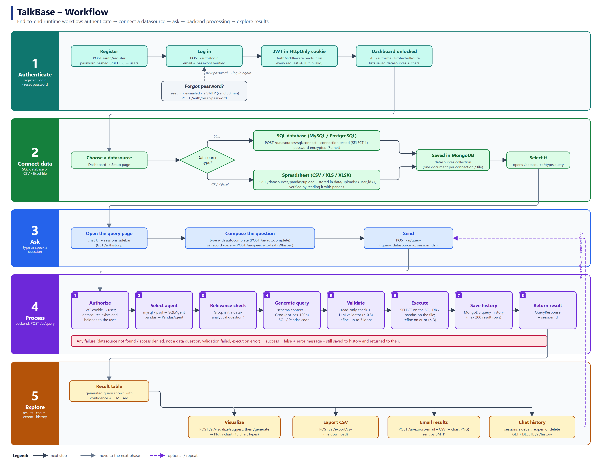
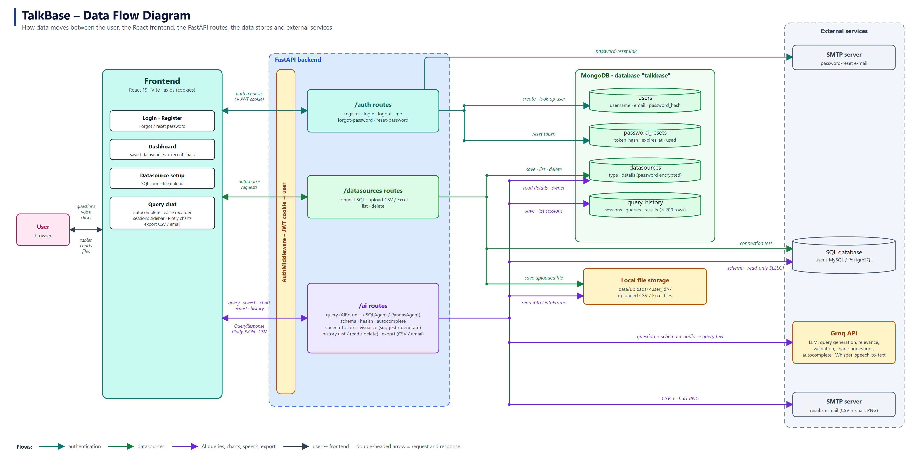

<div align="center">


# TalkBase

**Say it your way. Your data answers in its own.**

Ask questions about a MySQL or PostgreSQL database, or a CSV / Excel file, in plain language, by typing or speaking.
TalkBase translates them into SQL or Pandas, runs them read-only, and brings back a table, a chart and an export.

<sub>React 19 · Vite · Tailwind CSS 4 · FastAPI · MongoDB · Groq LLMs · Plotly</sub>

</div>

---

> **TalkBase**: talk to your database. You speak plain language; MySQL, PostgreSQL and Pandas each need their own query language, and TalkBase translates for you.

## Contents

- [What it does](#what-it-does)
- [How a question is translated](#how-a-question-is-translated)
- [Quick start](#quick-start)
- [Configuration](#configuration)
- [Using the app](#using-the-app)
- [Sample data](#sample-data)
- [API reference](#api-reference)
- [Safety and security](#safety-and-security)
- [Design system](#design-system)
- [Architecture diagrams](#architecture-diagrams)
- [Project structure](#project-structure)
- [Tests](#tests)
- [Troubleshooting](#troubleshooting)

## What it does

| | |
| --- | --- |
| **Plain language in, query out** | One endpoint (`POST /ai/query`) serves PostgreSQL, MySQL and CSV / Excel. The AI router picks a `SQLAgent` or a `PandasAgent` from the datasource type, so the user never chooses a query language. |
| **Shows its work** | Every answer includes the exact SQL or Pandas code that was generated, plus the row count, the model used and a validation confidence score. For SQL it also labels the query as 2NF or 3NF. |
| **Self-correcting** | A second LLM validates each generated query (accepted at confidence of 0.8 or more) and the query is refined up to 3 times. If execution fails, the LLM repairs the query and retries (up to 3 attempts). |
| **Stays on topic** | Questions that are not about data (greetings, general knowledge, coding help) get a polite request to ask a data-related question instead of a made-up query. |
| **Voice input** | Hold the mic and speak. Audio is transcribed with Groq Whisper; non-English speech is translated to English first. |
| **Autocomplete** | Schema-aware suggestions appear as you type, generated from your real table and column names and cached for 5 minutes. |
| **Charts** | The LLM suggests chart types for a result, and 13 Plotly types can be rendered: line, bar, horizontal bar, stacked bar, grouped bar, pie, scatter, histogram, box, area, heatmap, funnel and waterfall. |
| **Export and share** | Download results as CSV, or e-mail them (CSV plus an optional chart image) over SMTP. |
| **Chat history** | Every question and answer is stored per chat session. Reopen a session from the dashboard or the in-chat sidebar, or delete it. |
| **Accounts** | Register, log in, stay signed in ("remember me"), and reset a forgotten password by e-mail. |

## How a question is translated

```
 "Which 3 categories earned the most revenue in the last 3 months?"
                         │
                         ▼
   1. Relevance guardrail    is this question about data?
                         ▼
   2. Schema context         tables and columns, read from your database or file
                         ▼
   3. Generate               gpt-oss-120b writes SQL (MySQL / PostgreSQL)
                             or Pandas (CSV / Excel)
                         ▼
   4. Validate and refine    llama-3.3-70b checks it; up to 3 rounds, confidence ≥ 0.8
                         ▼
   5. Safety check           read-only only: SELECT / WITH for SQL, AST checks for Pandas
                         ▼
   6. Execute                on failure the error goes back to the LLM; up to 3 attempts
                         ▼
   table + generated query + chart suggestions + export   →   saved to your chat history
```

The agents live in `backend/ai/agents/`: `base.py` holds the shared refine and retry loop, while `sql_agent.py` and `pandas_agent.py` hold the dialect-specific parts. Groq calls are in `backend/ai/llm/`.

## Quick start

### Prerequisites

- **Python 3.10 or newer**
- **Node.js 20.19 or newer** (Node 22 LTS recommended; required by Vite 7)
- **MongoDB** running locally (or a remote URI). It stores users, saved connections and chat history.
- A **Groq API key** from <https://console.groq.com> (needed for every AI feature)
- Optional: a MySQL or PostgreSQL database to query, and SMTP credentials for e-mail features

### 1. Backend

```powershell
cd backend
python -m venv myvenv
myvenv\Scripts\activate            # macOS / Linux: source myvenv/bin/activate
pip install -r requirements.txt
copy .env.example .env             # macOS / Linux: cp .env.example .env
```

Open `backend/.env` and set at least `AUTH_JWT_SECRET` and `GROQ_API_KEY` (see [Configuration](#configuration)). Then start the API:

```powershell
uvicorn app:app --reload --host 0.0.0.0 --port 8000
```

The interactive API docs are at <http://localhost:8000/docs>.

### 2. Frontend

In a second terminal:

```powershell
cd frontend
npm install
npm run dev
```

Open <http://localhost:5173>. The frontend calls the API on port 8000 of whichever host it was loaded from, so opening it from a phone on the same Wi-Fi works too. Set `VITE_API_URL` to point it somewhere else.

### 3. First run

1. Create an account with **Get started**.
2. On the dashboard choose **SQL** (MySQL / PostgreSQL) or **Spreadsheet** (CSV / Excel).
3. Connect a source, then ask your first question.

## Configuration

Everything is set in `backend/.env` (template: `backend/.env.example`).

| Variable | Required | Default | Purpose |
| --- | :---: | --- | --- |
| `AUTH_JWT_SECRET` | yes | none | Secret used to sign login tokens. Generate one with `python -c "import secrets; print(secrets.token_urlsafe(48))"` |
| `GROQ_API_KEY` | yes | none | Groq key for generation, validation, charts, autocomplete and speech |
| `MONGO_URI` | no | `mongodb://localhost:27017` | MongoDB connection string |
| `MONGO_DB_NAME` | no | `talkbase` | Database name inside MongoDB |
| `AUTH_TOKEN_EXPIRE_MINUTES` | no | `60` | Normal session length |
| `AUTH_REMEMBER_ME_EXPIRE_MINUTES` | no | `43200` | Session length with "Remember me" (30 days) |
| `AUTH_COOKIE_NAME` | no | built-in | Name of the session cookie |
| `COOKIE_SECURE` | no | `false` | Set `true` when serving over HTTPS |
| `COOKIE_SAMESITE` | no | `lax` | Cookie SameSite policy |
| `CORS_ORIGINS` | no | none | Extra allowed browser origins, comma-separated |
| `FRONTEND_URL` | no | `http://localhost:5173` | Base URL used in password-reset links |
| `PASSWORD_RESET_EXPIRE_MINUTES` | no | `30` | Lifetime of a reset link |
| `SMTP_HOST`, `SMTP_PORT`, `SMTP_USER`, `SMTP_PASSWORD`, `SMTP_FROM`, `SMTP_USE_TLS` | no | none | Needed only for e-mailing results and password resets |

## Using the app

| Screen | What you do there |
| --- | --- |
| **Home** | Overview, with a live demo: pick a sample question and watch the query type out and the answer appear. |
| **Dashboard** | Total queries and data sources, quick actions for SQL and Spreadsheet, **Recent chats** (resume or delete) and **Saved connections** (query or delete). |
| **Connect SQL** | Choose MySQL or PostgreSQL and enter host, port, database, user and password. The password is encrypted before it is stored. |
| **Connect Spreadsheet** | Upload a `.csv`, `.xlsx` or `.xls` file. It is read once to confirm it is valid. |
| **Chat** | Type or speak a question. Each answer shows the generated query, the result table (50 rows per page), chart suggestions, and export / e-mail buttons. The sidebar lists past sessions and starts a new chat. |

Tip: start typing anywhere on the chat page and the input is focused for you; Enter sends the question.

## Sample data

`backend/utils/` contains scripts for demo data. Two of them work on their own; the Python database scripts need the tables to exist first.

| Script | What it does |
| --- | --- |
| `postgres_sample_databases.sql` | **Ready to run.** Creates five small PostgreSQL databases (school, library, hospital, restaurant, company) with tables and sample rows. Run it once from **SQL Shell (psql)** with `\i` |
| `excel_hr_attrition_populator.py`, `excel_sales_kpi_populator.py`, `excel_supply_chain_populator.py`, `excel_populator.py` | **Ready to run.** Write demo Excel / CSV files into `backend/data/` that you can upload as a spreadsheet. See `backend/EXCEL_DATA_GUIDE.md` |
| `mysql_ecommerce_populator.py`, `mysql_retail_inventory_populator.py`, `mysql_saas_subscriptions_populator.py` | Insert thousands of fake rows into the MySQL databases `ecommerce`, `retail_inventory`, `saas_subscriptions` |
| `psql_fintech_transactions_populator.py`, `psql_logistics_shipments_populator.py`, `psql_marketing_campaigns_populator.py` | Insert fake rows into the PostgreSQL databases `fintech_transactions`, `logistics_shipments`, `marketing_campaigns` |

**Before running the six database scripts:** they only insert rows. The database and its tables must already exist (the table definitions are not part of this repo); otherwise the script stops with "database does not exist" or "relation does not exist". The MySQL scripts use port 3306 only and need `mysql-connector-python`, which is not in `requirements.txt`.

The Python scripts read their settings from environment variables: `MYSQL_HOST`, `MYSQL_USER`, `MYSQL_PASSWORD`, `MYSQL_DATABASE`, `POSTGRES_HOST`, `POSTGRES_PORT`, `POSTGRES_USER`, `POSTGRES_PASSWORD`, `POSTGRES_DATABASE`, and `EXCEL_*_FILE` / `EXCEL_*_ROWS` for the workbooks. Check the defaults at the top of each script (they include a placeholder password) before running.

```powershell
pip install mysql-connector-python
python utils/mysql_ecommerce_populator.py
```

## API reference

The datasource and AI routes require the session cookie that `/auth/login` sets. Full request and response schemas are at `/docs` while the backend is running.

**Auth** (`/auth`)

| Method | Path | Purpose |
| --- | --- | --- |
| POST | `/auth/register` | Create an account |
| POST | `/auth/login` | Sign in and set the HTTP-only session cookie |
| POST | `/auth/logout` | Clear the cookie |
| GET | `/auth/me` | Current user |
| POST | `/auth/forgot-password` | E-mail a reset link |
| POST | `/auth/reset-password` | Set a new password from a reset link |

**Datasources** (`/datasources`)

| Method | Path | Purpose |
| --- | --- | --- |
| GET | `/datasources/` | List the user's saved sources |
| POST | `/datasources/sql/connect` | Test and save a MySQL / PostgreSQL connection |
| POST | `/datasources/pandas/upload` | Upload and save a CSV / Excel file |
| DELETE | `/datasources/{datasource_id}` | Delete a saved source |

**AI** (`/ai`)

| Method | Path | Purpose |
| --- | --- | --- |
| POST | `/ai/query` | Translate a question, run it and return results |
| GET | `/ai/schema/{datasource_id}` | Schema of a datasource |
| GET | `/ai/health` | Status of the AI services |
| POST | `/ai/visualize/suggest` | Suggest chart types for a result |
| POST | `/ai/visualize/generate` | Render a chosen chart as Plotly JSON |
| POST | `/ai/autocomplete` | Suggestions for a partial question |
| DELETE | `/ai/autocomplete/cache/{datasource_id}` | Clear cached suggestions |
| POST | `/ai/speech-to-text` | Transcribe audio (webm, mp4, m4a, mp3, wav, ogg or flac, up to 25 MB) |
| GET | `/ai/history` | List chat sessions |
| GET | `/ai/history/{session_id}` | Messages in one session |
| DELETE | `/ai/history/{session_id}` | Delete a session |
| POST | `/ai/export/csv` | Export results as CSV |
| POST | `/ai/export/email` | E-mail results over SMTP |

## Safety and security

- **Read-only SQL.** Generated SQL must start with `SELECT` or `WITH` and is rejected if it contains write keywords (see `FORBIDDEN_SQL_KEYWORDS` in `sql_agent.py`).
- **Sandboxed Pandas.** Generated Pandas code is checked against forbidden patterns, parsed with Python's AST, and evaluated in a restricted namespace with a safe set of builtins. Pandas results are capped at 1000 rows.
- **Passwords.** Account passwords are hashed with PBKDF2-SHA256 (Passlib).
- **Sessions.** Login issues a JWT stored in an HTTP-only cookie; the SameSite and Secure flags are configurable.
- **Stored database credentials.** Saved MySQL / PostgreSQL passwords are encrypted with Fernet (key derived with PBKDF2) before they reach MongoDB, and are never returned by the API.
- **Ownership.** Datasources, chat history and uploaded files are tied to the signed-in user.
- **Secrets stay out of git.** `.env` is git-ignored; only `.env.example` is committed.

## Design system

The interface uses an **Aurora glass** look: a dark navy page with a soft sky-blue and violet glow, and frosted, translucent panels on top.

| Token | Colour | Used for |
| --- | --- | --- |
| `brand` | Sky blue | Main accent: buttons, links, focus rings |
| `violet` | Violet | Second end of the sky-to-violet gradient |
| `lang` | Mint | Generated SQL and Pandas code blocks |
| `ink` | Navy and soft lavender-white | Backgrounds, panels and text |

- **Glass:** panels use the `.surface` class (translucent white, blurred backdrop, light inner edge). The page background is `.bg-app`, the gradient text is `.text-gradient` and the primary button gradient is `.btn-gradient`.
- **Type:** Inter for the interface and JetBrains Mono for queries.
- **Motion:** a fade-in on the hero, an interactive demo on the Home page (typed query, growing chart bars, mic pulse). All motion is switched off for people who prefer reduced motion.
- **Logo:** two speech bubbles, sky for the human and violet for the query, in `frontend/public/logo.svg` and `frontend/src/components/Logo.jsx`.
- **Changing it:** every colour and font is a token in the `@theme` block of `frontend/src/index.css`, and components use the token names, so a re-theme is mostly a one-file edit.

## Architecture diagrams





More diagrams:

- [ER diagram](ER%20diagram.png): the MongoDB collections `users`, `password_resets`, `datasources` and `query_history`
- [UML class diagram](UML.png): controller, AI router, agents, services and schemas
- [Activity diagram](Activity.png): what happens during `POST /ai/query`, including the failure path and retry loops
- [Sequence diagram](sequence.png): message-by-message flow of one question

## Project structure

```
TalkBase/
├── backend/
│   ├── app.py                 FastAPI app, CORS, auth middleware, startup checks
│   ├── auth/                  register / login / reset, JWT cookie, user store
│   ├── datasources/           connect SQL, upload files, encrypted credential store
│   ├── ai/
│   │   ├── router.py          /ai/* endpoints
│   │   ├── agents/            base (refine + retry loop), sql_agent, pandas_agent, visualization_agent
│   │   ├── llm/               Groq client and fallback
│   │   ├── autocomplete.py    schema-aware suggestions
│   │   ├── history_store.py   chat sessions in MongoDB
│   │   └── speech.py          Whisper transcription
│   ├── utils/                 MongoDB, e-mail, sample-data populators
│   ├── data/uploads/          uploaded CSV / Excel files (git-ignored)
│   ├── test_*.py              scripted checks
│   └── *_GUIDE.md             autocomplete, Excel data and visualization guides
├── frontend/
│   ├── public/logo.svg        logo and favicon
│   └── src/
│       ├── index.css          design tokens, fonts, helper classes
│       ├── components/        Logo, Navbar, Footer, Button, Card, Input, PhrasePair, Loading
│       │   └── datasource/    common (chat, sidebar, charts, export, voice), sql, spreadsheet
│       ├── pages/             Home, Login, Register, Forgot / Reset password, Dashboard,
│       │                      DataSourceSetup, QueryPage, NotFound
│       └── utils/api.js       Axios client (cookie credentials, VITE_API_URL)
├── REPORT_README.md           report-ready write-up of the system
├── IEEE_PAPER_README.md       conference-paper draft
└── *.png                      architecture diagrams
```

## Tests

The scripts in `backend/` check individual features. With the backend virtual environment active:

```powershell
cd backend
pip install pytest
python -m pytest test_sql_normal_form.py
```

`test_sql_normal_form.py` is a pytest module for the 2NF / 3NF labelling. `test_autocomplete.py`, `test_excel_data.py` and `test_visualization.py` are scripted checks for autocomplete, the Excel data generators and chart generation; read the top of each file for what it needs. On the frontend, `npm run build` confirms the bundle compiles and `npm run lint` runs ESLint.

## Troubleshooting

| Symptom | Fix |
| --- | --- |
| `vite` is not recognized | Run `npm install` inside `frontend/` first. |
| Backend cannot reach MongoDB at startup | Start MongoDB, or correct `MONGO_URI` in `backend/.env`. |
| Every AI answer fails | Set a valid `GROQ_API_KEY`. `GET /ai/health` shows whether the Groq client is available. |
| Browser shows CORS errors | Open the frontend from `http://localhost:5173`, or add its origin to `CORS_ORIGINS`. |
| Logged out after every refresh | Keep the default cookie settings for local HTTP; set `COOKIE_SECURE=true` only when serving over HTTPS. |
| E-mail or password reset fails | Fill in all `SMTP_*` variables; the error names any that are missing. |
| `py` or `python` not found on Windows | Install Python 3.10+ and tick "Add python.exe to PATH", then restart the terminal. |
| `activate` is blocked in PowerShell | Run `Set-ExecutionPolicy -Scope Process Bypass` once in that window. |
